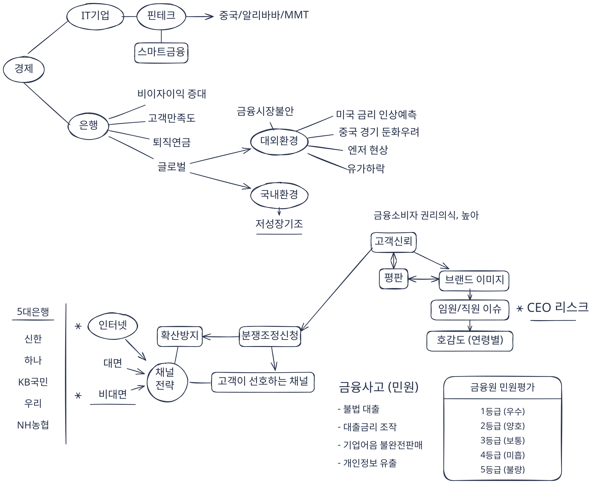

## 데이터보다 먼저 비즈니스를 이해해야 했다

오래전 금융권의 VOC(Voice of Customer, 고객의 소리) 분석 시스템을 구축했던 이야기를 해볼까 한다.

당시 나는 시스템 아키텍처를 설계하기에 앞서 금융 산업의 환경을 마인드맵으로 정리했다. 금융시장의 변화, 경쟁 은행의 전략, 고객 만족, 금융 소비자 보호, 상품과 채널, 민원과 평판까지. 얼핏 보면 데이터 엔지니어링과 직접적인 관련이 없어 보이는 내용들이었다.

그러나 나에게는 중요한 작업이었다. **데이터를 어떻게 저장하고 처리할 것인가보다, 무엇을 분석해야 하는지 이해하는 것이 먼저였기 때문이다.**

고객의 불만을 분석한다고 생각해 보자.

거시적으로는 금융회사는 왜 VOC 분석하려고 하는가?

당시 금융 산업은 핀테크 기업의 등장과 디지털 채널의 확대로 새로운 경쟁 환경을 맞이하고 있었다. 금융회사는 고객의 불만을 처리하는 것을 넘어, 고객의 경험과 신뢰를 데이터로 이해해야 했다. 나는 VOC 분석이 단순한 민원 통계가 아니라 고객 관계와 금융회사의 경쟁력을 이해하는 수단이라고 생각했다.

또 하나는 세부적으로 어떤 고객이 불만을 제기했는가? 어떤 상품과 관련되어 있는가? 어느 채널에서 발생했는가? 경쟁사에 대한 언급은 있는가? 불만의 원인은 무엇인가?

이러한 질문을 정의해야 비로소 데이터를 어떻게 분류하고 집계할지 결정할 수 있다. 당시 우리는 고객유형, 경쟁사, 상품, 채널, 불만 유형 등을 분석 관점(Dimension)으로 정의했다. VOC 건수, 긍정 건수, 부정 건수, 평판지수, 토픽 키워드 등은 분석 지표와 결과로 구성했다. 그리고 이러한 분석 관점과 지표를 바탕으로 데이터 마트와 분석 화면을 설계했다.

**비즈니스를 이해하고, 분석 관점을 정의한 다음, 데이터 구조를 설계한다.** 이것은 지금도 내가 데이터 엔지니어링에서 중요하게 생각하는 원칙이다.

## MapR로 구축했던 VOC 데이터 플랫폼

당시 구축했던 OO은행 통합 VOC 시스템에는 MapR 기반의 분산 데이터 플랫폼을 도입했다.

수집 채널은 다양했다. 기존 VOC 시스템뿐 아니라 콜센터의 STT(Speech-to-Text) 데이터, 민원시스템 등 여러 곳에서 데이터가 들어왔다. 원천 시스템에서 생성한 파일은 EAI(Enterprise Application Integration)를 통해 수신했다. 이후 분석엔진이 데이터를 처리하고, 분석 목적에 맞게 구조화하여 테이블에 적재했다.

데이터 저장에는 MapR-DB를 사용했다. MapR-DB는 HBase API를 통해 접근할 수 있는 분산 NoSQL 데이터베이스였다.

당시 데이터 마트는 크게 세 단계로 구성했다.

- **수집 마트:** 원천 시스템에서 들어온 데이터를 수집하고 관리하는 영역 (Bronze)
- **분석 마트:** 분석 관점과 지표를 중심으로 데이터를 구성하는 영역 (Silver)
- **대시보드 마트:** 사용자가 분석 결과를 빠르게 조회하도록 제공하는 영역 (Gold)

수집 마트와 분석 마트는 MapR-DB에 저장했고, 최종 대시보드 마트는 RDB로 구성했다. 오늘날 Databricks에서 설명하는 Medallion Architecture의 Bronze, Silver, Gold와 개념적으로 닮은 부분이 있다. 물론 당시에는 그런 명칭을 사용하지 않았고, 저장 기술과 처리 방식도 달랐다. 다만 원천 데이터와 분석 데이터, 서비스용 데이터를 목적에 따라 구분했다는 점에서 비슷한 설계 고민을 찾아볼 수 있다.

그런데 시스템을 구축하면서 예상보다 어려웠던 것은 데이터를 저장하는 일이 아니었다. **여러 시스템의 데이터를 정확하게 수집하고, 신뢰할 수 있는 분석 결과를 만드는 일이었다.**

## 분산 저장은 가능했지만, 정확한 집계는 또 다른 문제였다

MapR 기반 환경에서 복잡한 다차원 분석 쿼리를 실행하다 보면 일부 집계 건수가 일치하지 않는 문제가 발생했다. 조회 기간이 길어지면 성능도 좋지 않았다.

초기 분석 과정에서는 Apache Drill을 사용했던 것으로 기억한다. 다만 오래전 프로젝트라 정확한 적용 범위까지는 기억나지 않는다.

집계 오류는 실제 운영에서 가볍게 넘길 수 있는 문제가 아니었다. 예를 들어 VOC 건수가 조회할 때마다 달라진다면 사용자는 어느 결과를 믿어야 할까? 데이터 분석에서 성능도 중요하지만, 분석 결과에 대한 신뢰가 무너지면 시스템의 가치는 크게 떨어진다.

우리는 MapR 엔지니어에게 테스트 환경을 제공하고 문제를 재현하며 SR(Service Request)을 진행하기도 했다. 최종적으로 문제는 우회 방법을 통해 해결했던 것으로 기억한다.

그 과정에서 대시보드 마트를 RDB로 구성하여 빠른 조회 성능과 신뢰할 수 있는 집계 결과를 대시보드로 제공했다. 대용량 데이터를 저장하고 분석하는 기술과 사용자에게 안정적으로 결과를 제공하는 기술을 상황에 맞게 구성하였다.

**대용량 데이터를 저장할 수 있다는 것과, 그 데이터를 정확하고 빠르게 서비스할 수 있다는 것은 서로 다른 문제다.**

## 금융권에 불었던 Hadoop 데이터레이크 열풍

이후 금융권에서는 Hadoop을 활용한 빅데이터 프로젝트가 활발하게 진행됐다. 당시에는 여러 조직에 흩어진 정형·비정형 데이터를 한곳에 수집해 데이터레이크를 구축하는 것이 중요한 흐름이었다.

기존에는 Exadata 같은 고성능 SQL 엔진을 중심으로 데이터를 처리하는 경우가 많았다. 이러한 시스템은 성능이 뛰어났지만, 대규모 데이터를 계속 확대해 저장하고 분석하려면 비용 부담도 컸다. 왠지 모르겠으나 국내에는 탈오라클 경향이 있고 지금도 꾸준히 지속되고 있다. ([카카오, 6년 여정 끝 '탈 오라클' 완료…특정 SW 종속 탈피하고 비용 절감](https://www.etnews.com/20260120000336))

Hadoop은 다른 선택지를 제공했다. 상대적으로 경제적인 분산 저장 환경을 구축하고, 조직 전체의 데이터를 모아 다양한 분석에 활용할 수 있었다.

이후 프로젝트에서는 Hive를 사용했다. Hive는 당시 업계의 표준 기술로 자리 잡아가고 있었고, 집계 결과의 정확성 측면에서도 신뢰할 수 있었다. 물론 기존 고성능 SQL 엔진보다 느렸다. 하지만 기업의 기술 선택은 성능만으로 결정되지 않는다. 정확성, 비용, 확장성, 운영 가능성을 함께 고려해야 한다.

Hadoop 기반 데이터레이크에서는 크게 두 가지 방식으로 데이터를 활용했다. 하나는 웹 기반 SQL 노트북(Hive, Impala)에서 필요한 데이터를 직접 조회하는 방식이었다. 분석가는 SQL을 작성해 데이터를 탐색할 수 있었다. 다른 하나는 정기적으로 필요한 분석 데이터를 ETL로 처리해 분석 마트로 제공하는 방식이었다.

운영에 필요한 기능도 직접 구현했다. 데이터 파티션은 폴더 구조로 관리했고, 문제가 발생했을 때 다시 처리할 수 있도록 재실행 기능도 만들었다. 이러한 기능은 안정적인 데이터 파이프라인을 운영하기 위한 기본 요소였다.

그러나 데이터레이크가 모든 문제를 해결해 주지는 않았다.

## 데이터를 공유했지만, 컴퓨팅 자원은 경쟁해야 했다

웹 기반 SQL 노트북을 사용하면서 또 다른 문제를 경험했다. 누군가 대규모 쿼리를 실행하면 CPU와 메모리를 많이 점유했다. 그동안 다른 사용자들은 자신의 분석 작업이 끝나기를 기다려야 했다.

운영자는 대기열을 조회해 누가 어떤 작업을 실행하고 있는지 확인했다. 그리고 기다렸다. 당시에는 이러한 자원 경합을 자동으로 해결하는 별도의 시스템적 대응이 없었다.

돌이켜보면 조금 답답한 운영 방식이었다. 기업 전체의 데이터를 한곳에 모아 공유할 수 있게 되었지만, 데이터를 분석하기 위한 컴퓨팅 자원까지 자유롭게 사용할 수 있었던 것은 아니었다.

**데이터는 공유할 수 있었지만, 컴퓨팅 자원은 서로 경쟁해야 했다.**

대용량 데이터를 저장하는 문제를 해결하고 나니, 이번에는 데이터를 처리하는 자원의 효율성과 운영 문제가 중요해졌다. 이러한 경험을 하고 나서 클라우드 데이터 플랫폼의 변화를 접했을 때 여러 기술이 새롭게 보이기 시작했다.

## 클라우드는 데이터 플랫폼을 바라보는 관점을 바꾸었다

오브젝트 스토리지, ELT, 컬럼형 데이터, Spark, Kafka. 개별 기술도 흥미로웠지만, 내게 더 놀라웠던 것은 이 기술들이 만들어내는 전체적인 변화였다.

과거에는 데이터를 수집하고 분석하려면 저장소부터 처리 엔진, 파티션 관리, 재실행 기능, 자원 운영까지 많은 것을 직접 구현해야 했다. 그런데 클라우드 데이터 플랫폼에서는 이러한 기능들을 관리형 서비스나 플랫폼의 기능으로 활용할 수 있게 되었다.

오브젝트 스토리지는 대규모 데이터를 저장하는 방식을 바꾸었다. Athena 같은 서버리스 SQL 서비스는 오브젝트 스토리지의 파일을 SQL로 직접 조회할 수 있게 해준다. Glue의 크롤러와 데이터 카탈로그는 데이터 구조와 메타데이터를 관리하는 데 도움을 준다. 과거에는 수집할 데이터를 찾는 것부터 쉽지 않았다. 업무 담당자와 데이터 소유 부서를 확인하고 IT 담당자와 수집 절차를 협의하는 데 상당한 시간이 필요했다. 데이터 카탈로그는 이러한 과정 중 데이터의 위치와 구조를 파악하는 부담을 줄여준다. 다만 데이터의 업무적 의미와 접근 권한을 확인하는 과정에는 여전히 사람과 조직의 협력이 필요하다.

과거에는 원천 데이터를 분석하기 위해 별도의 데이터베이스나 마트를 먼저 구성해야 하는 경우가 많았다. 이제는 원천 파일을 탐색하는 과정 자체가 훨씬 간편해질 수 있다.

ETL에서 ELT로의 변화도 눈여겨볼 만하다. 기존에는 데이터를 추출하고 변환한 다음 적재하는 흐름이 중심이었다면, ELT는 먼저 데이터를 적재하고 처리 엔진에서 필요한 형태로 변환한다. Parquet 같은 컬럼형 파일 형식과 자동화된 데이터 파이프라인은 분석용 데이터를 생성하고 관리하는 방식을 발전시켰다.

Spark는 대규모 분산 데이터 처리를, Kafka는 이벤트 기반 데이터 흐름을 이해하는 데 중요한 기술이었다. 그리고 최근에는 Databricks와 같은 Lakehouse 플랫폼을 공부하면서 저장소와 컴퓨팅 엔진, 데이터 관리 기능이 어떻게 결합하고 분리되는지 살펴보고 있다.

아직 모든 서비스를 직접 사용해 본 것은 아니다. 지금도 공부하고 비교하는 과정에 있다. 그럼에도 과거 Hadoop 환경을 구축하고 운영했던 경험이 있기 때문에 이러한 변화가 왜 중요한지 조금은 다르게 다가온다.

**데이터 엔지니어가 시스템을 유지하기 위해 쏟던 노력을 줄이고, 데이터 자체에 더 집중할 수 있게 되었다는 점이다.**

## 비즈니스는 더 이상 데이터를 오래 기다리지 않는다

기술의 변화보다 더 중요한 것은 비즈니스의 속도다. 과거에는 데이터를 정기적으로 수집하고, 야간 배치로 처리하고, 다음 날 분석 결과를 제공하는 방식이 자연스러웠다. 물론 지금도 정기 배치가 적합한 업무는 많다.

하지만 모든 데이터를 고비용·고지연의 ETL 작업으로 처리하는 방식만으로는 빠르게 변하는 비즈니스의 요구를 따라가기 어렵다. 기업은 고객의 행동과 시장의 변화를 더 빠르게 파악하려 한다. 애플리케이션은 최신 데이터를 필요로 하고, AI Agent는 필요한 순간에 데이터를 조회하고 활용해야 한다.

이러한 환경에서는 데이터를 얼마나 많이 저장했는가보다 **필요한 데이터를 얼마나 정확하고 빠르게 제공할 수 있는가**가 중요해진다.

그렇다면 데이터 파이프라인의 역할도 달라져야 한다. 단순히 데이터를 A 시스템에서 B 시스템으로 이동시키는 것이 아니라, 다양한 원천의 데이터를 연결하고, 의미를 정리하고, 신뢰할 수 있는 형태로 서비스에 공급해야 한다.

## 데이터의 길목을 장악한다는 것

데이터가 애플리케이션과 AI Agent의 중요한 원자재인 시대가 되었다. 자동차 산업에서 석유가 원자재의 가치를 가졌듯이, 데이터 역시 수많은 디지털 서비스와 AI의 기반이 된다.

사용자가 실제로 경험하는 것은 데이터베이스가 아니라 애플리케이션이다. 그리고 애플리케이션이 제공하는 기능과 AI Agent의 판단 뒤에는 데이터가 있다.

그렇다면 데이터의 길목을 장악한다는 것은 무엇일까?

데이터의 길목을 확보한다는 것은 단순히 데이터를 소유하는 일이 아니다. 여러 시스템에 흩어진 데이터를 연결하고, 의미를 정리하고, 필요한 순간에 신뢰할 수 있는 형태로 공급하는 능력을 확보하는 것이다. 나는 앞으로 데이터 플랫폼의 경쟁력이 이러한 연결과 공급 능력에서 더욱 뚜렷해질 것이라고 생각한다.

많은 기업은 중요한 데이터를 보유하고 있지만, 고도화된 데이터 플랫폼을 모두 독자적으로 구축하고 유지하기는 쉽지 않다. 따라서 전문 데이터 플랫폼 기업의 역할과 영향력은 앞으로 더 커질 가능성이 있다.

그렇다고 기업이 자신의 핵심 데이터를 모두 외부에 맡기지는 않을 것이다. 경쟁력의 원천이 되는 데이터는 직접 통제하려 할 것이고, 보안과 규제도 중요한 판단 기준이 될 것이다.

나는 이런 이유로 하이브리드 클라우드와 프라이빗 클라우드가 계속 중요한 역할을 할 것이라고 생각한다. 기업은 데이터를 통제하면서도 급속도로 발전하는 외부 플랫폼의 처리 능력과 기술을 활용하려 할 것이다.

결국 데이터 경제의 중요한 경쟁은 데이터의 소유권뿐 아니라 **데이터를 활용 가능하게 만드는 플랫폼과 연결 구조**에서도 일어날 것이다.

## 다시, 오래전의 마인드맵으로

여기까지 생각하고 나니 오래전 VOC 프로젝트를 시작하면서 그렸던 마인드맵이 다시 떠오른다. 당시 나는 MapR-DB나 분석엔진부터 설계하지 않았다. 먼저 금융 산업과 고객의 문제를 이해하려 했다. 그리고 무엇을 분석해야 하는지 정의하고, 분석 화면과 데이터 마트를 설계했다. 기술은 그 목적을 구현하기 위한 수단이었다.

시간이 지나 데이터 플랫폼의 모습은 크게 달라졌다. Hadoop과 Hive를 지나 오브젝트 스토리지, Spark, Lakehouse, AI Agent까지 기술은 계속 발전하고 있다. 그러나 내가 생각하는 데이터 엔지니어링의 본질은 크게 달라지지 않았다.

데이터 엔지니어는 SQL, Python, 데이터 파이프라인 서비스 등과 같은 기본 구현 기술을 충분히 익혀야 한다. 처리 엔진과 데이터 구조를 이해하고 실제로 구현할 수 있어야 한다. 하지만 그것만으로는 부족하다.

비즈니스를 이해해야 어떤 데이터를 수집하고, 어떻게 정제하고, 무엇을 기준으로 집계할지 판단할 수 있다. 데이터가 처리되는 전체 과정을 이해해야 집계 결과가 왜곡되는 것을 발견하고, 분석 결과를 검증할 수 있다.

**데이터 엔지니어에게 중요한 것은 비즈니스 전체를 보는 능력이다.**

비즈니스의 질문에서 출발해 데이터의 수집, 정제, 집계, 분석, 서비스까지 하나의 흐름으로 바라보는 능력. 그리고 그 흐름 속에서 데이터가 의미와 가치를 잃지 않도록 설계하는 능력.

내가 생각하는 데이터 파이프라인의 본질은 바로 거기에 있다.
